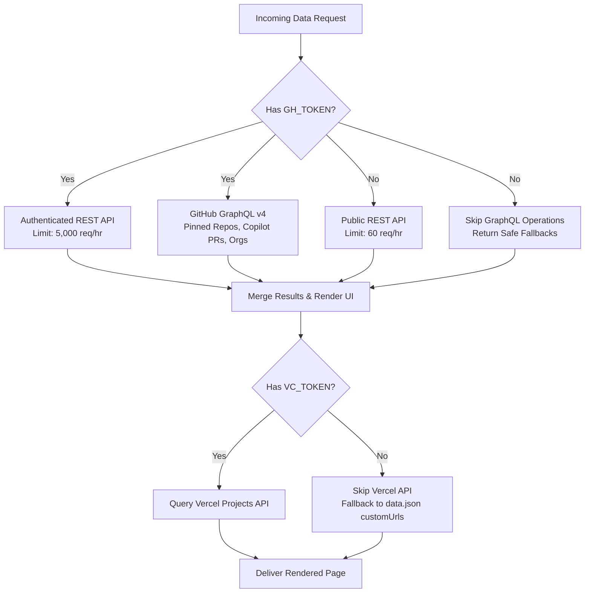

# System Architecture Documentation

This document provides a comprehensive technical breakdown of the architecture, design principles, rendering models, data pipelines, caching mechanisms, and error resilience strategies used across the Portfolio application.

---

## 1. High-Level Architecture Overview

The portfolio is built as a high-performance, dynamic developer showcase running on **Next.js 16** (utilizing the App Router) with **React 19** and **Tailwind CSS v4**. 

Unlike standard static portfolio templates, this system functions as an **autonomous developer dashboard and telemetry hub** that aggregates live repository metadata, real-time commit activity, Vercel deployments, framework upgrades, security alerts, and visitor traffic directly from GitHub and Vercel APIs.

```mermaid
graph TD
    Client[Web Browser Client] -->|HTTP Request| NextServer[Next.js 16 App Router Server]

    subgraph Presentation & Routing
        NextServer --> RootLayout[Root Layout: app/layout.jsx]
        RootLayout --> HomePage[Home: app/page.jsx]
        RootLayout --> ProjectsPage[Projects: app/projects/page.jsx]
        RootLayout --> ContactPage[Contact: app/contact/page.jsx]
        RootLayout --> SearchPage[Search: app/search/page.jsx]
        NextServer --> APIFallback[Pages Router Fallback: pages/api/users/[username].js]
    end

    subgraph Data Layer & Caching Engine [app/data.js]
        HomePage --> DataLayer[Data Fetching Module]
        ProjectsPage --> DataLayer
        ContactPage --> DataLayer
        DataLayer --> UnstableCache[Next.js unstable_cache Engine]
        UnstableCache --> MemoryCache[(Next.js Tagged Server Cache)]
    end

    subgraph External Telemetry & APIs
        DataLayer -->|REST API v3| GhRest[GitHub REST API]
        DataLayer -->|GraphQL v4| GhGql[GitHub GraphQL API]
        DataLayer -->|Traffic & Alerts| GhSec[GitHub Traffic & Dependabot]
        DataLayer -->|Vercel REST v9| VercelApi[Vercel Projects API]
    end

    subgraph Static Configuration
        DataLayer --> DataJson[Local data.json Profile Config]
    end
```

---

## 2. Rendering Model & Component Boundaries

The application uses Next.js React Server Components (RSC) by default to eliminate client-side JavaScript overhead and maximize Core Web Vitals (LCP, FID/INP, CLS).

### 2.1 Server Components (RSC)
Components that fetch data, parse schemas, or aggregate APIs run entirely on the server. They output pure HTML/CSS to the client:
- **`app/page.jsx`**: Evaluates active user parameter, initiates concurrent data fetches via `Promise.all` or asynchronous Suspense boundaries.
- **`app/projects/page.jsx` & `projects.jsx`**: Server-side repository classification, sorting, chunking, and Vercel project matching.
- **`app/projects/article.jsx`**: Server component resolving traffic views, Dependabot security advisories, and Copilot pull requests.
- **`app/components/recent-activity.jsx`**: Reduces GitHub event streams (commits, reviews, comments, tags, branches) into human-readable activity sentences.
- **`app/components/vercel-info.jsx`**: Inspects remote repository `package.json` blobs to detect frameworks and compares versions with latest upstream releases.
- **`app/components/orgs.jsx`**: Resolves organization memberships via GitHub GraphQL.
- **`app/components/resume.jsx`**: Formats structured career timelines, education, and credentials from `data.json`.

### 2.2 Client Components (`"use client"`)
Interactive components that depend on browser APIs (DOM events, hooks, form states, IntersectionObserver) are isolated into lightweight client bundles:
- **`app/components/nav.jsx`**: Uses `useRef`, `useState`, and `IntersectionObserver` to trigger sticky glassmorphic navigation transitions when scrolling past the hero section.
- **`app/components/search-input.jsx`**: Interactive GitHub user query box with keyboard hooks, real-time validation, and debounce management.
- **`app/contact/contact-form.jsx`**: Stateful form with asynchronous submission transitions, input validation, and animated feedback states.
- **`app/components/popover.jsx`**: Hover-triggered tooltips displaying Turbopack and framework status badges.
- **`app/components/loading-indicator.jsx`**: Next.js route navigation indicator utilizing `useLinkStatus`.

---

## 3. Hybrid Routing Architecture

While the frontend is powered by the **Next.js App Router**, the project maintains a **Pages Router API endpoint** for dedicated lightweight JSON proxying.

```
portfolio/
├── app/                  # Next.js App Router
│   ├── layout.jsx        # Global HTML structure, fonts, SEO metadata
│   ├── page.jsx          # Landing page with dynamic Suspense boundaries
│   ├── projects/         # Repository showcase grouped by tier
│   ├── contact/          # Split-screen contact directory & message form
│   ├── search/           # Dynamic GitHub user lookup engine
│   └── api/
│       └── contact/
│           └── route.js  # App Router API endpoint for contact messages
└── pages/
    └── api/
        └── users/
            └── [username].js  # Next.js Pages API proxy for username verification
```

### Why a Pages Router API route?
The route [`pages/api/users/[username].js`](file:///h:/Seffin/Protfolio/portfolio/pages/api/users/%5Busername%5D.js) serves as an internal API proxy for the client-side `UserSearch` component. By requesting the user via this server-side proxy rather than making client-side calls to `api.github.com`:
1. It avoids exposing personal access tokens in client browser network traces.
2. It bypasses browser CORS constraints on third-party APIs.
3. It keeps client bundle size minimal by leveraging server-side `fetch`.

---

## 4. Caching & Performance Architecture

The data access layer [`app/data.js`](file:///h:/Seffin/Protfolio/portfolio/app/data.js) is engineered to prevent hitting GitHub API rate limits (which is 60 requests/hour for unauthenticated users and 5,000 requests/hour for authenticated tokens) while delivering instantaneous page transitions.

### 4.1 Server-Side Tiered Cache (`unstable_cache`)

Every remote fetch operation is wrapped in Next.js `unstable_cache` with tailored Time-To-Live (TTL) tiers and cache tags:

| Cache Tier | TTL | Functions Covered | Rationale |
| :--- | :--- | :--- | :--- |
| **5 Minutes (`MINUTES_5`)** | 300s | `getRecentUserActivity` | Live commit streams and reviews update frequently. |
| **1 Hour (`HOURS_1`)** | 3,600s | `getTrafficPageViews`, `getRepositoryPackageJson`, `getFrameworkLatestRelease`, `getRepositoryFrameworks` | GitHub traffic metrics lag by 24h; upstream framework releases change infrequently. |
| **12 Hours (`HOURS_12`)** | 43,200s | `getRepos`, `getPinnedRepos`, `getUserOrganizations`, `getSocialAccounts`, `getVercelProjects`, `getDependabotAlerts`, `getCopilotPRs`, `getCopilotPRsAccountWide` | Stable profile, project lists, and security alert states require long persistence. |
| **24 Hours (`HOURS_24`)** | 86,400s | `checkAppJsxExistence` | Repository structure (App Router vs Pages Router) changes rarely. |

### 4.2 Client-Side Route Caching (`staleTimes`)

Configured in [`next.config.mjs`](file:///h:/Seffin/Protfolio/portfolio/next.config.mjs):
```javascript
experimental: {
    staleTimes: {
        dynamic: 300, // Caches dynamic search-param routes for 5 minutes
        static: 300   // Caches static layouts and route payloads for 5 minutes
    }
}
```
When users navigate between `/`, `/projects`, and `/contact`, Next.js preserves the client router cache, making page switching instant without trigger-loading waterfalls or API hits.

---

## 5. Graceful Degradation & Resilience Strategy

The system is designed to run reliably in both fully authenticated production environments and zero-token development environments:



### Safety Fallbacks:
1. **Missing `GH_TOKEN`**:
   - `getPinnedRepos` returns an empty array without failing the page.
   - `getUserOrganizations` returns an empty organization list.
   - `getDependabotAlerts` returns `{}` and hides security badges.
   - `getCopilotPRs` and `getCopilotPRsAccountWide` return `0`.
2. **Missing `VC_TOKEN`**:
   - `getVercelProjects` logs a note and returns `{ projects: [] }`. The projects page continues to function by falling back to `data.json`'s `projects.customUrls` and repository homepage URLs.
3. **Repository Package Inspection**:
   - Non-JavaScript or headless repositories lacking a `package.json` return `null` without throwing parsing errors.
4. **Hydration Protection**:
   - Dynamic user-dependent text elements and Suspense fallbacks protect against SSR/client markup discrepancies.

---

## 6. Build-Time Resolution

During `next build`:
1. [`next.config.mjs`](file:///h:/Seffin/Protfolio/portfolio/next.config.mjs) executes at build time.
2. If `GH_TOKEN` is present, it queries `https://api.github.com/user` to dynamically resolve the authenticated user's login handle.
3. If no token is provided, it falls back to the `githubUsername` defined in [`data.json`](file:///h:/Seffin/Protfolio/portfolio/data.json).
4. This value is injected into `process.env.GITHUB_USERNAME` as a global build-time constant.
