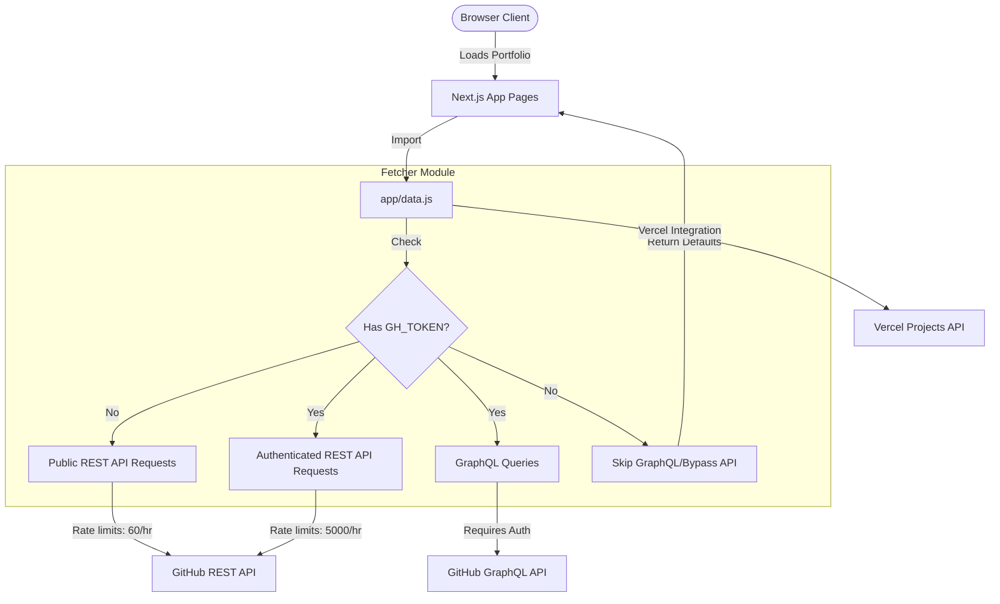

# Portfolio Project Architecture & Guide

Welcome to the project guide for your GitHub portfolio. This document explains the architecture, directory structure, data flow, API integrations, and how to customize the application.

---

## 1. Directory Structure

The project uses Next.js with **App Router** for the pages, and a single **Pages Router** endpoint for API routing fallback.

```text
portfolio/
├── .env.example          # Template for local environment variables
├── .env.local            # Local environment overrides (tokens)
├── data.json             # Personal profiles, descriptions, and projects configuration
├── package.json          # Dependency definition, build scripts, and ESM configurations
├── next.config.mjs       # Next.js bundler config, env loading, and client caching rules
├── postcss.config.js     # PostCSS styling config (Tailwind CSS integration)
├── tailwind.config.js    # Tailwind theme customization (fonts, keyframes, transitions)
│
├── public/               # Static assets
│   ├── favicon.ico       # Portfolio favicon
│   └── fonts/            # CalSans font files
│
├── app/                  # Next.js App Router root folder
│   ├── layout.jsx        # Root HTML layout and dynamic metadata definitions
│   ├── page.jsx          # Homepage (landing screen with title and navigation)
│   ├── data.js           # Data-fetching module integrating GitHub & Vercel APIs
│   │
│   ├── components/       # Shared UI components
│   │   ├── nav.jsx            # Dynamic top navigation bar
│   │   ├── search-input.jsx   # Input box to dynamically search GitHub users
│   │   ├── recent-activity.jsx# Client-side user GitHub activity timeline
│   │   └── vercel-info.jsx    # Vercel deployment status badges
│   │
│   ├── contact/          # Contact Page (/contact)
│   │   └── page.jsx      # Social accounts card view
│   │
│   ├── projects/         # Projects Page (/projects)
│   │   ├── page.jsx      # Repository lists grouped by hierarchy (featured, top, others)
│   │   └── article.jsx   # Individual repository project card displaying stats
│   │
│   └── search/           # GitHub Search Page (/search)
│       └── page.jsx      # View another user's portfolio by entering their username
│
├── resume.tex            # LaTeX format resume with contact details & portfolio link
└── pages/
    └── api/
        └── users/
            └── [username].js  # Next.js API route fetching raw GitHub profile info
```

---

## 2. Core Architecture & Data Flow



### Data Fetching Module (`app/data.js`)
This module handles all external integrations. It is optimized to perform API calls efficiently and cache results using Next.js `unstable_cache`.

#### Integrations & Methods:
1. **GitHub REST API**:
   - `getUser`: Fetches profile information (avatar, display name, bio).
   - `getRepos`: Fetches up to 100 repositories owned by the user.
   - `getSocialAccounts`: Resolves linked social media accounts from the profile.
   - `getRecentUserActivity`: Fetches user events (commits, issues, pull requests) to build the activity timeline.
2. **GitHub GraphQL API** (Only runs if `GH_TOKEN` is present):
   - `getPinnedRepos`: Fetches repositories pinned by the user on their GitHub profile.
   - `getRepositoryPackageJson`: Reads `package.json` inside the repository to analyze UI frameworks and dependencies.
   - `getCopilotPRs` & `getCopilotPRsAccountWide`: Searches for merged pull requests authored by GitHub Copilot.
3. **Vercel API** (Only runs if `VC_TOKEN` is present):
   - `getVercelProjects`: Fetches projects hosted on Vercel to cross-reference with GitHub repositories and display live deployment URLs.

---

## 3. Caching & Performance Optimization

To deliver instant loading speeds and respect GitHub's API rate limits, the portfolio employs aggressive caching strategies:

### Server-Side Caching (`unstable_cache`)
API responses are cached with custom revalidation tags:
- **5 Minutes (`MINUTES_5`)**: Used for highly dynamic content like recent GitHub activity (`getRecentUserActivity`).
- **1 Hour (`HOURS_1`)**: Used for framework release tracking (`getFrameworkLatestRelease`, `getTrafficPageViews`, `getRepositoryPackageJson`).
- **12 Hours (`HOURS_12`)**: Used for stable data like project repositories, social accounts, organizations, and Copilot statistics.
- **24 Hours (`HOURS_24`)**: Used for file existence checks (`checkAppJsxExistence`).

### Client-Side Route Caching (`staleTimes`)
Defined in `next.config.mjs`:
```javascript
experimental: {
    staleTimes: {
        dynamic: 300, // Caches dynamic pages (like query search pages) for 5 minutes
        static: 300   // Caches static layouts and routes for 5 minutes
    }
}
```
This cache allows users to click back and forth between pages instantly without triggering full page reloads or API roundtrips.

---

## 4. Customizing the Portfolio

You configure the website's display data via `data.json`. No code edits are required to customize your profile info.

### Configuration Schema (`data.json`):
```json
{
    "githubUsername": "Seffin",
    "description": "My hobby projects, most of them are Next.js apps deployed to Vercel.",
    "avatarUrl": "",
    "displayName": "",
    "email": "seffintommathew@gmail.com",
    "projects": {
        "showForks": true,
        "blacklist": [],
        "heroNames": []
    }
}
```

#### Properties:
- `githubUsername`: **(Required)** Your exact GitHub handle (without `@` or spaces). Used to target all API requests.
- `description`: A custom bio paragraph displayed on the home page.
- `avatarUrl`: Override to load a custom avatar image instead of your GitHub profile photo.
- `displayName`: Custom display name (defaults to your GitHub handle if empty).
- `email`: Contact email address.
- `projects.showForks`: Boolean to determine whether to display forked repositories on the projects page. Defaults to `false` if not set.
- `projects.customUrls`: A key-value object linking repository names to custom deployment URLs (e.g. `{"vachan-study-chat": "https://vachan-study-chat-snpm.vercel.app/"}`). Helpful for projects deployed under a different Vercel project name or external hosts.
- `projects.blacklist`: Array of repository names (e.g. `["secret-repo", "playground"]`) that you want to hide from the projects page.
- `projects.heroNames`: Array of repository names (e.g. `["my-app", "portfolio"]`) that should be featured as large "Hero" projects at the top of the `/projects` page.

---

## 5. Development & Builds

### Building for Production:
```sh
npm run build
```
This builds an optimized version of the Next.js site. The build script resolves the repository owner username by:
1. Checking if a `GH_TOKEN` is present to fetch the username from the token's authenticated owner.
2. Falling back to the `githubUsername` defined in `data.json` if no token exists.

### Local Development:
```sh
npm run dev
```
Starts the development server on `http://localhost:3000`.

- **Without tokens**: Bypasses private analytics/GraphQL fetch steps, avoiding rate limits. You can immediately review layout structures.
- **With tokens**: Provides full data visualization (Dependabot badges, unique visitors traffic graphs, Vercel deployments, etc.). Create `.env.local` containing:
  ```env
  GH_TOKEN=your_github_personal_access_token
  VC_TOKEN=your_vercel_token
  ```
